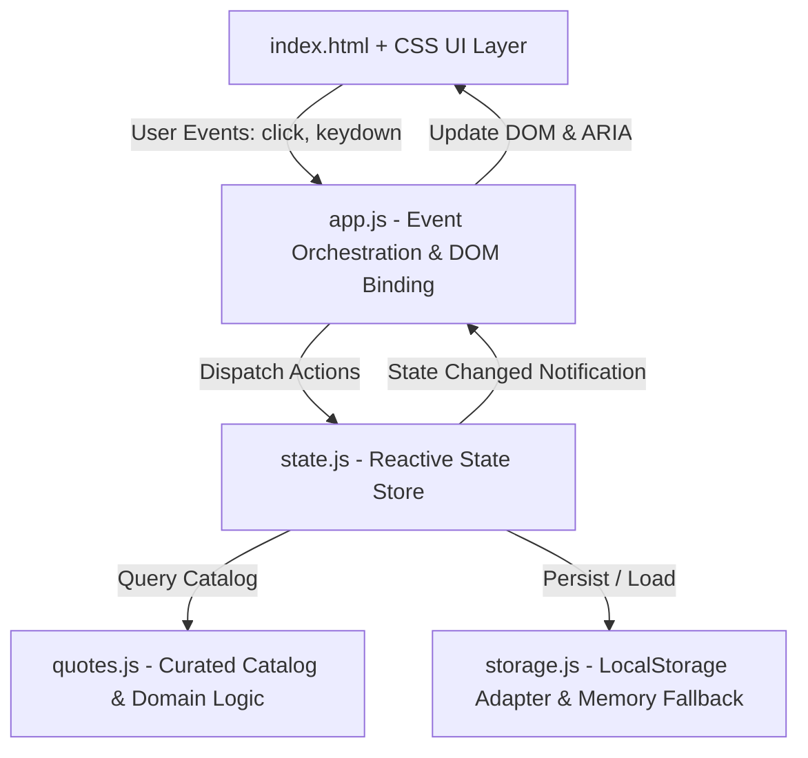

# Technical Plan: Quote of the Day

## 1. Architecture Overview
The application is structured as a client-only Single Page Application (SPA) leveraging standard browser capabilities without frameworks or backend servers.



## 2. Component Design & Responsibilities

### 2.1 File & Directory Layout
```
quote-of-the-day/
├── .speckit/
│   ├── constitution.md     # Engineering principles and invariants
│   ├── specification.md    # Product specification and acceptance criteria
│   ├── plan.md             # Architecture and implementation design
│   └── tasks.md            # Work breakdown and execution tracking
├── index.html              # Semantic HTML5 entry point
├── css/
│   └── style.css           # Modern CSS3 styling (custom properties, responsive)
├── js/
│   ├── quotes.js           # Catalog of quotes, getRandomQuote, getQuoteById
│   ├── storage.js          # Resilient storage manager with localStorage + memory fallback
│   ├── state.js            # Observable state manager (currentQuote, favorites, history)
│   ├── app.js              # View controller, DOM listeners, keyboard shortcuts, toasts
│   └── utils.js            # Clipboard helper, string formatting, date seed helper
├── tests/
│   ├── quotes.test.js      # Unit tests for quote data & selection logic
│   ├── storage.test.js     # Unit tests for storage manager & fallbacks
│   └── state.test.js       # Unit tests for state actions & event notifications
├── package.json            # NPM test script & project configuration
└── README.md               # User guide and project overview
```

### 2.2 Storage Schema
- Storage Key: `qod_favorites_v1`
- Format: JSON-serialized array of quote IDs (or records):
  ```json
  [1, 7, 14]
  ```
- Validation on read:
  - If payload is malformed or invalid JSON, safely reset to `[]` and warn.
  - Filter out any non-existent quote IDs.
- Quota & Security Handling:
  - Wrap all `localStorage.getItem` and `localStorage.setItem` in `try...catch`.
  - Fall back to an internal JavaScript `Set` if `localStorage` throws `SecurityError` or `QuotaExceededError`.

### 2.3 State Management (`state.js`)
- **State Object:**
  - `currentQuote`: The quote object currently on screen.
  - `favoriteIds`: A `Set` of quote IDs that the user has favorited.
  - `quoteHistory`: Array of recently viewed quote IDs (to prevent recent repeats).
- **Actions:**
  - `init()`: Loads favorites from storage, selects initial quote, emits update.
  - `nextQuote()`: Selects a new random quote different from `currentQuote`.
  - `setCurrentQuote(id)`: Displays a specific quote (e.g. from favorites list).
  - `toggleFavorite(id)`: Adds or removes `id` from `favoriteIds`, persists to storage, emits update.
  - `isFavorite(id)`: Returns boolean whether `id` is favorited.
  - `getFavorites()`: Returns array of full quote objects for all favorited IDs.
- **Event Dispatcher:**
  - Simple pub/sub mechanism `subscribe(listener)` that triggers whenever state changes.

### 2.4 User Interface & Interaction Design
- **Card Design:** Centered card with clean typography, quotation marks glyph, author attribution, and tag badge.
- **Actions Row:**
  - "New Quote" button (primary accent color, subtle icon).
  - "Favorite" toggle button (heart icon with smooth scale animation).
  - "Copy Quote" button (clipboard icon with transient checkmark/toast).
  - "Share" button (opens Web Share dialog or Twitter intent).
- **Navigation / Header:**
  - App title with theme toggle indicator and "Favorites (N)" drawer trigger button.
- **Favorites Modal / Drawer:**
  - Slide-in side drawer or accessible modal.
  - Shows list of favorited quotes with author and a "Remove" button.
  - Clicking a quote card loads it as the active quote on the main screen.

### 2.5 Testing Strategy
- Tests will run via Node.js native test runner (`node --test`), requiring zero external dependencies.
- Unit tests verify:
  1. `quotes.js`: Catalog completeness, unique IDs, non-repeating random selection.
  2. `storage.js`: LocalStorage interaction, corrupt payload recovery, in-memory fallback.
  3. `state.js`: State updates, favorite toggling, persistence coordination, subscriber notifications.
